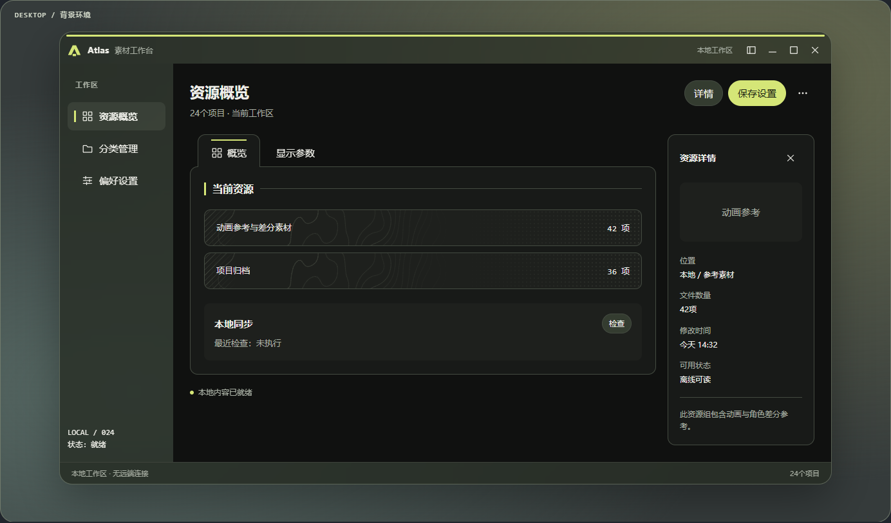
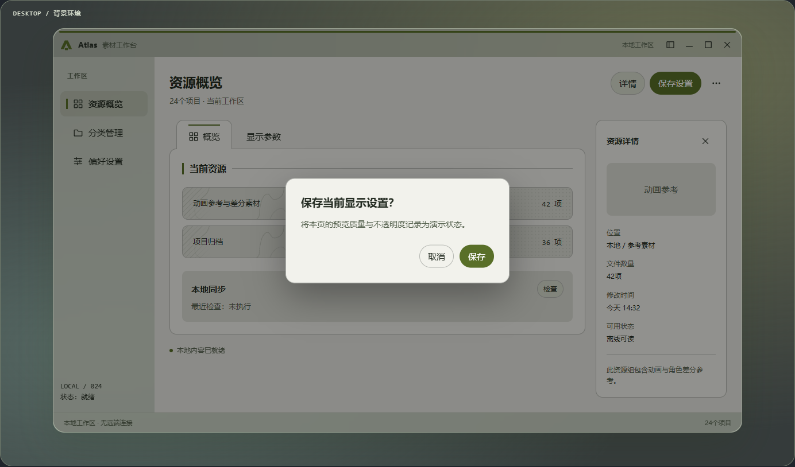
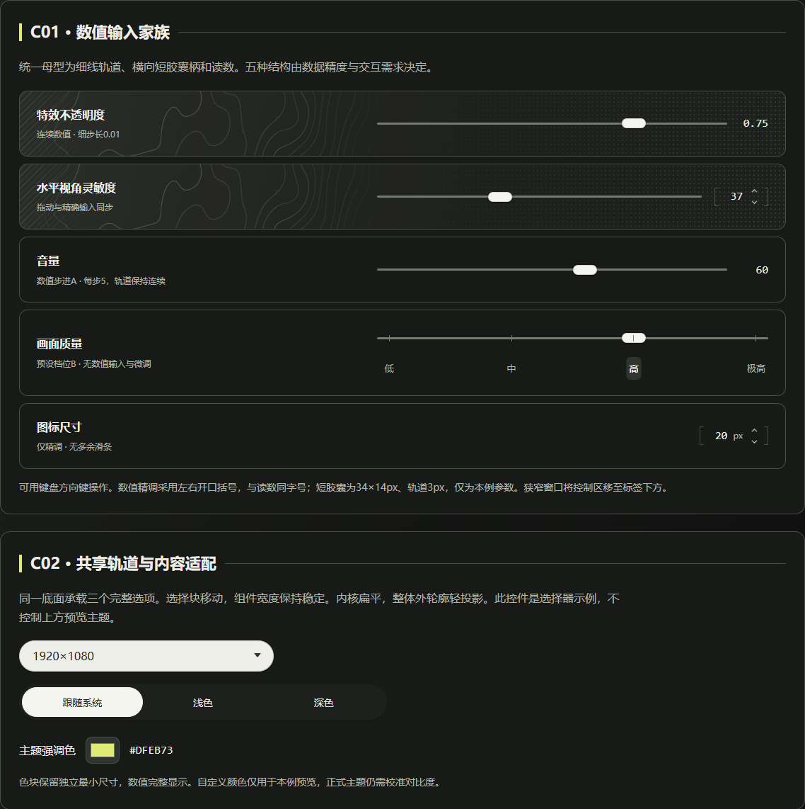
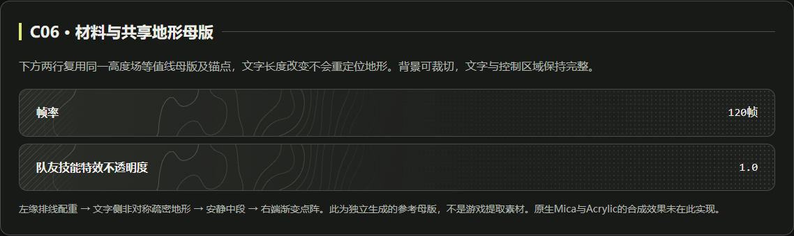

# Nekori Softframe｜柔框设计语言

**柔和外壳 × 工业内构 × 扁平表达**

Nekori Softframe 是一套基于个人审美形成的混合式 UI 设计语言与参考资料集，选择性融合三种设计倾向：

- **Apple｜外层柔和：** 窗口轮廓、适度圆角、柔和材质、透明层次与空间关系。
- **Arknights: Endfield｜内部秩序：** 工业式几何分区、直角装饰、纸墨配色、技术线条、点阵、排线与等高线。
- **Microsoft｜扁平与清晰：** 清楚的信息层级、简洁控件、稳定排版与克制的交互反馈。

这些倾向按界面层级分配职责：**外层可以柔和，内部可以方正，内容始终清晰易读。** 这不意味着内部组件全部直角，也不意味着全面使用玻璃效果；具体以现行规范为准。

本项目主要服务于个人软件开发，公开提供设计规则与独立 HTML 案例。它并非上述品牌或作品的官方设计系统，也不是像素级复刻。

## 设计特点

- **材料各司其职：** 外壳、导航、纸墨内容与临时浮层分级，密集内容保持稳定底色。
- **装饰服从信息：** 共享地形母版、局部排线与渐变点阵参与构图，不覆盖阅读和操作。
- **结构先于外观：** 控件按数据类型和精度选择；导航形式依项目而定，新功能先确定归属。

## 案例展示

以下图片直接截自仓库现有 HTML 的真实渲染，未修改案例布局；它们是设计参考，不是正式软件成品。浏览器材料为视觉模拟，原生 Mica/Acrylic 仍需在宿主验证。

### 纸色主题与 Owner 模态

展示稳定的内容底色、所属窗口遮罩以及确认框的前后关系。

### 数值与选择控件

C01 与 C02 的连续区域：细线轨道、短胶囊柄、开口精调及共享选择轨道。

### 工业装饰与纸墨表面

C06 使用共享地形母版，将等高线、排线和点阵放在内容周围的受控区域。

## 从这里开始

- **AI执行入口：**[AI-INDEX.md](AI-INDEX.md)，按任务读取对应小节。
- **整体窗口：**[窗口与层级HTML](案例/窗口与层级.html)，标题身份、材料分级、两种导航形式及浮层。
- **内部组件：**[组件HTML](案例/index.html)，数值、仪表、按钮、节点、标签与排序。
- **案例状态：**[案例说明](案例/README.md)，当前参考、历史源码与检查局限。

HTML下载后可直接本地打开，无外部依赖。GitHub文件页用于查看源码，交互前请下载仓库。无法读取图片的AI可完整使用。

## 主题目录

| 主题 | 文件 | 内容 |
| --- | --- | --- |
| 信息架构与命令 | [01](规范/01-结构与命令.md) | 功能归属、入口、表达、确认顺序与风险 |
| 材质与工业表面 | [02](规范/02-材质与工业表面.md) | 纸墨、材料角色、纹理分区、共享地形与密度 |
| 组件规则 | [03](规范/03-组件规则.md) | 已合并有效修正；滑条、精调、仪表、按钮、节点与标签 |
| 字体图标与动效 | [04](规范/04-资源与参数.md) | 默认资源、备选、连续性、试验参数及素材职责 |
| 来源与核对状态 | [05](规范/05-来源与核对状态.md) | Apple/Microsoft、社区项目、Rahoo与已知缺口 |
| 文字案例索引 | [06](规范/06-案例索引.md) | C01–C12、W01的结构、交互与禁止项 |
| 修订记录 | [07](规范/07-组件修正补充.md) | 历史链接兼容，非额外执行补丁 |
| 窗口与层级 | [08](规范/08-窗口与层级.md) | 标题身份、材料分级、可变导航及组件角色对应 |

## 使用约定

1. 意图与功能归属先于布局和装饰；新功能不自动产生新页面、按钮或导航。
2. 左栏、顶部标签、分支节点是形式；语义层级由具体项目决定。
3. 正文规范是当前规则；案例是独立重建参考，像素参数不自动成为固定标准。
4. 试验参数、备选资源、未验证能力保持其原状态。
5. 普通控件保留已确定圆角；几何分区、直角装饰与主体圆角各有职责。

## 来源与许可证

原创 Markdown 文档、HTML 示例与设计实现采用 [WTFPL v2](LICENSE)，允许自由复制、修改、分发及商业使用。第三方代码、素材和其他独立作品仍遵循各自原始许可，不因本仓库的许可证而改变。

主要设计来源、社区参考及授权核对见[来源与核对状态](规范/05-来源与核对状态.md)。当前仓库未打包第三方字体、图标库或 Rahoo 部署脚本。原始聊天和迁移附件保留在本地，不是阅读依赖。
